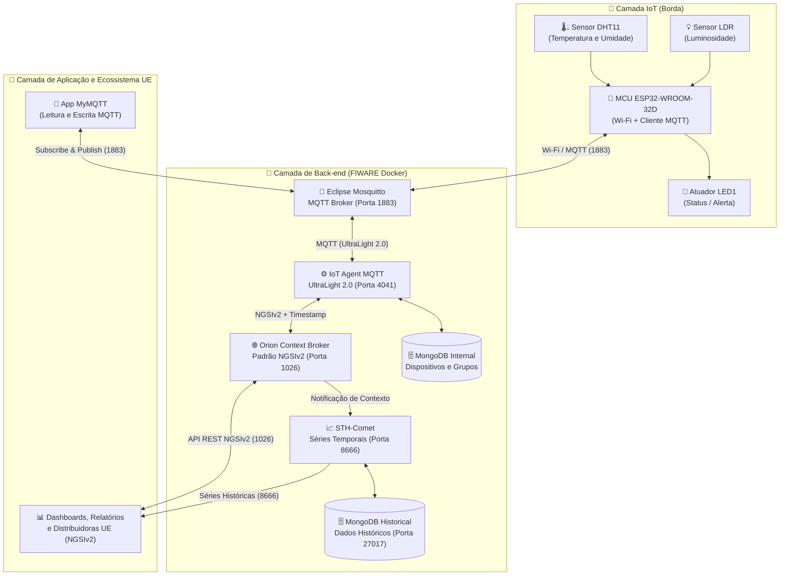

# 🍷 Vinheria Agnello — Smart Wine Cellar IoT & FIWARE


> **Checkpoint 05 — Edge Computing & Computer Systems**  
> Solução IoT ponta a ponta para monitoramento ambiental (luminosidade, temperatura e umidade) e rastreabilidade histórica da adega da **Vinheria Agnello**, interoperável com o ecossistema da **União Europeia** via **FIWARE (NGSIv2)**, **Smart Data Models** e **MQTT**.  
> **Professor:** Prof. Me. Lucas Demetrius Augusto (`proflucas.augusto@fiap.com.br`) | **Turma:** 1ESPQ

---

## 📌 Sobre o Projeto e o Desafio de Negócio

Com o avanço da Internet das Coisas (*Internet of Things — IoT*), a **Vinheria Agnello** iniciou a evolução tecnológica de suas operações visando expandir suas atividades no **mercado europeu**. Após a validação da primeira fase do projeto, os proprietários da vinheria levantaram novas demandas essenciais para garantir o controle rigoroso da adega e a integração com distribuidoras internacionais:

> *"Isso é legal! O sistema me avisa que o ambiente está muito claro e consigo tomar as providências necessárias, mas também precisamos monitorar a temperatura e a umidade do ambiente... Ah sim, as luzinhas são interessantes, mas eu preciso saber exatamente qual a temperatura e a umidade do depósito, senão não consigo ter o controle!"*
>
> *"Preciso ter os dados históricos dos últimos dias e meses!"*
>
> *"Queremos exportar os dados históricos para a geração de gráficos, análises e relatórios promovendo a rastreabilidade das condições de armazenamento dos nossos vinhos desde a sua entrada em nosso depósito!"*
>
> *"Queremos integrar nossa empresa a distribuidoras presentes no mercado Europeu"*

Para atender a esses requisitos na **Fase 2**, este projeto implementa a captura contínua de dados ambientais com **ESP32 (DHT11 + LDR)** via **Wi-Fi** e **MQTT**, integrada ao back-end **FIWARE** sob o padrão **NGSIv2** e **Smart Data Models (União Europeia)**, além de supervisão e comando remoto em tempo real pelo aplicativo **MyMQTT**.

---

## 🌡️ Fatores Críticos para a Qualidade do Vinho

A conservação adequada dos rótulos na adega depende do controle simultâneo de três grandezas físicas monitoradas pelos sensores do sistema:

| Parâmetro | Impacto Físico-Químico no Vinho | Faixa Ideal de Conservação | Sensor no Projeto |
| :--- | :--- | :--- | :--- |
| 💡 **Luminosidade** | A iluminação deve ser muito suave (penumbra). Vinhos brancos e espumantes sofrem mais com a luz; raios ultravioletas (UV) alteram compostos orgânicos e iniciam reações químicas que geram resultados desagradáveis. | **Ambiente em penumbra** (baixa luminosidade) | **LDR** *(Fotoresistor)* |
| 🌡️ **Temperatura** | O calor excessivo encerra rapidamente a vida útil do vinho, e flutuações térmicas acima de **3 °C** causam o aparecimento de aromas indesejados. | **~13 °C constantes** *(estudo de Alexander Pandell, PhD, Univ. da Califórnia)* | **DHT11** |
| 💧 **Umidade** | A falta de umidade resseca o vedante (rolha), causando má vedação e risco de oxidação do líquido. O excesso danifica os rótulos e promove a proliferação de fungos. | **Próxima a 70%** *(variação aceitável entre **60% e 80%**)* | **DHT11** |

---

## 🎯 Requisitos Técnicos e Funcionalidades

- [x] **Comunicação via MQTT:** Envio contínuo das leituras dos sensores do ESP32 para a plataforma de back-end **FIWARE** por meio do broker **Eclipse Mosquitto**.
- [x] **Rastreabilidade com *Timestamp*:** Inclusão de marcação temporal (`TimeInstant` ISO 8601) em cada leitura armazenada para auditoria histórica de dias e meses.
- [x] **Conectividade Wi-Fi no MCU:** Transmissão sem fio das informações coletadas pelo microcontrolador **ESP32-WROOM-32D** diretamente para a internet/servidor.
- [x] **Conformidade NGSIv2 e Smart Data Models:** Interface padronizada (*Next Generation Service Interface*) para interoperabilidade com distribuidoras do mercado da União Europeia.
- [x] **Persistência Histórica (Séries Temporais):** Armazenamento automático das variações de temperatura, umidade e luminosidade via **STH-Comet** e **MongoDB**.
- [x] **Leitura e Escrita via App MyMQTT:** Visualização em tempo real das medições (`Subscribe`) e envio de comandos de atuação (`Publish`) pelo smartphone.

---

## 🏗️ Arquitetura da Solução (FIWARE + IoT)

O diagrama abaixo representa o fluxo de dados entre a camada física de sensores/atuadores (**IoT**), o back-end containerizado (**FIWARE Docker Compose**) e a camada de **Aplicação**:



---

## 🔌 Hardware e Esquema de Pinagem (ESP32)


### 🛠️ Componentes Utilizados

* **1x Microcontrolador:** ESP32-WROOM-32D (38 pinos, Wi-Fi 2.4 GHz integrado)
* **1x Sensor de Temperatura e Umidade:** DHT11
* **1x Sensor de Luminosidade:** LDR (Fotoresistor)
* **1x Atuador Luminoso:** LED (`LED1` na placa didática / protoboard)
* **Acessórios:** Placa didática FIAP (ou protoboard), *jumpers* coloridos e cabo Micro-USB

### ⚡ Mapa de Conexões (ESP32 ↔ Placa Didática)

Realize a montagem física seguindo exatamente as conexões especificadas na documentação de laboratório:

| Pino no ESP32 | Pino na Placa / Sensor | Cor do Fio (Esquema) | Tipo de Sinal | Descrição da Conexão |
| :---: | :---: | :---: | :---: | :--- |
| **`3V3`** | **`UCC` (VCC)** | 🔴 Vermelho | Alimentação | Fornece 3,3 V para alimentação dos sensores |
| **`GND`** | **`GND`** | ⚫ Preto | Terra (GND) | Referência comum de aterramento do circuito |
| **`D4` (GPIO 4)** | **`DHT` (DATA)** | 🔵 Azul | Digital (I/O) | Barramento de dados digitais do sensor **DHT11** |
| **`D34` (GPIO 34)** | **`LDR`** | 🟣 Roxo | Analógico (ADC1) | Leitura analógica de 12 bits (`0` a `4095`) do **LDR** |
| **`D2` (GPIO 2)** | **`LED1`** | 🟡 Amarelo | Digital (Output) | Saída digital para acionamento remoto via **MyMQTT** |

> [!WARNING]
> O pino **GPIO 34 (`D34`)** pertence ao conversor analógico-digital **ADC1** (`ADC1_CH6`). Em projetos com ESP32 utilizando Wi-Fi ativo, sempre utilize pinos do **ADC1** (GPIO 32 a 39) para leituras analógicas como o LDR, pois o **ADC2** sofre interferência do driver Wi-Fi.

---

## 📂 Estrutura do Repositório

```text
📦 vinheria-agnello-iot-cp05
 ┣ 📂 docker
 ┃ ┗ 📜 docker-compose.yml       # Orquestração da plataforma FIWARE (Orion, IoT Agent, STH-Comet, Mosquitto, MongoDB)
 ┣ 📂 postman
 ┃ ┗ 📜 fiware_collection.json   # Coleção Postman para provisionamento NGSIv2 e consultas históricas
 ┣ 📂 src
 ┃ ┗ 📜 vinheria_agnello.ino     # Firmware do ESP32 (DHT11 + LDR + Wi-Fi + MQTT UltraLight 2.0)
 ┣ 📂 docs
 ┃ ┗ 📜 montagem_esp32.png       # Diagrama de conexões físicas do hardware
 ┗ 📜 README.md                  # Documentação técnica do projeto
```

---

## 💻 Código-Fonte do ESP32 (`src/vinheria_agnello.ino`)

O firmware abaixo realiza a leitura conjunta do **DHT11** (temperatura em `°C` e umidade em `%`) e do **LDR** (luminosidade mapeada de `0` a `100%`), publicando os dados via Wi-Fi/MQTT tanto nos tópicos individuais quanto no formato **UltraLight 2.0** do FIWARE, além de escutar comandos de escrita vindos do aplicativo **MyMQTT**:

```cpp
#include <WiFi.h>
#include <PubSubClient.h>
#include <DHT.h>

// ================= CONFIGURAÇÕES DE WI-FI E BROKER MQTT =================
const char* SSID        = "SUA_REDE_WIFI";
const char* PASSWORD    = "SUA_SENHA_WIFI";
const char* BROKER_MQTT = "SEU_IP_SERVIDOR_FIWARE"; // IP da VM FIWARE / Broker Mosquitto
const int   BROKER_PORT = 1883;

// ================= TÓPICOS MQTT (FIWARE ULTRALIGHT 2.0 / MYMQTT) =================
const char* TOPICO_SUBSCRIBE    = "/TEF/wineCellar001/cmd";
const char* TOPICO_PUBLISH_ATTR = "/TEF/wineCellar001/attrs";
const char* TOPICO_PUBLISH_TEMP = "/TEF/wineCellar001/attrs/t";
const char* TOPICO_PUBLISH_HUM  = "/TEF/wineCellar001/attrs/h";
const char* TOPICO_PUBLISH_LUM  = "/TEF/wineCellar001/attrs/l";
const char* ID_MQTT             = "fiware_wineCellar001";

// ================= DEFINIÇÃO DOS PINOS DO HARDWARE =================
#define PIN_DHT 4     // GPIO 4 (D4) -> Barramento DATA do DHT11
#define DHTTYPE DHT11 // Modelo do sensor: DHT11
#define PIN_LDR 34    // GPIO 34 (D34 / ADC1_CH6) -> Sensor LDR
#define PIN_LED 2     // GPIO 2 (D2) -> Atuador LED1

DHT dht(PIN_DHT, DHTTYPE);
WiFiClient espClient;
PubSubClient MQTT(espClient);

unsigned long ultimoEnvio = 0;
const unsigned long INTERVALO_ENVIO = 5000; // Intervalo entre leituras (5 segundos)

void initWiFi() {
  delay(10);
  Serial.println("====== [Wi-Fi] Inicializando Conexao ======");
  Serial.print("Conectando-se a rede: ");
  Serial.println(SSID);

  WiFi.begin(SSID, PASSWORD);
  while (WiFi.status() != WL_CONNECTED) {
    delay(500);
    Serial.print(".");
  }

  Serial.println("\n[Wi-Fi] Conectado com sucesso!");
  Serial.print("[Wi-Fi] Endereco IP: ");
  Serial.println(WiFi.localIP());
}

void mqttCallback(char* topic, byte* payload, unsigned int length) {
  String msg;
  for (unsigned int i = 0; i < length; i++) {
    msg += (char)payload[i];
  }

  Serial.print("[MQTT] Comando recebido em [");
  Serial.print(topic);
  Serial.print("]: ");
  Serial.println(msg);

  // Acionamento do LED1 via MyMQTT ("on" / "off") ou comando NGSIv2 do FIWARE
  if (msg.equals("wineCellar001@on|") || msg.equalsIgnoreCase("on") || msg.equals("1")) {
    digitalWrite(PIN_LED, HIGH);
    MQTT.publish(TOPICO_PUBLISH_ATTR, "s|on");
    Serial.println("[ATUADOR] LED1 -> LIGADO (HIGH)");
  } else if (msg.equals("wineCellar001@off|") || msg.equalsIgnoreCase("off") || msg.equals("0")) {
    digitalWrite(PIN_LED, LOW);
    MQTT.publish(TOPICO_PUBLISH_ATTR, "s|off");
    Serial.println("[ATUADOR] LED1 -> DESLIGADO (LOW)");
  }
}

void initMQTT() {
  MQTT.setServer(BROKER_MQTT, BROKER_PORT);
  MQTT.setCallback(mqttCallback);
}

void reconnectMQTT() {
  while (!MQTT.connected()) {
    Serial.print("[MQTT] Conectando ao Broker (");
    Serial.print(BROKER_MQTT);
    Serial.println(")...");

    if (MQTT.connect(ID_MQTT)) {
      Serial.println("[MQTT] Conectado com sucesso!");
      MQTT.subscribe(TOPICO_SUBSCRIBE);
      Serial.print("[MQTT] Inscrito no topico: ");
      Serial.println(TOPICO_SUBSCRIBE);
    } else {
      Serial.print("[MQTT] Falha na conexao. Codigo: ");
      Serial.print(MQTT.state());
      Serial.println(" | Tentando novamente em 2s...");
      delay(2000);
    }
  }
}

void verificaConexoes() {
  if (WiFi.status() != WL_CONNECTED) {
    initWiFi();
  }
  if (!MQTT.connected()) {
    reconnectMQTT();
  }
}

void setup() {
  Serial.begin(115200);
  pinMode(PIN_LED, OUTPUT);
  digitalWrite(PIN_LED, LOW);

  dht.begin();
  initWiFi();
  initMQTT();
}

void loop() {
  verificaConexoes();
  MQTT.loop();

  unsigned long agora = millis();
  if (agora - ultimoEnvio >= INTERVALO_ENVIO) {
    ultimoEnvio = agora;

    // 1. Captura de Temperatura (°C) e Umidade (%) pelo DHT11
    float temperatura = dht.readTemperature();
    float umidade     = dht.readHumidity();

    // 2. Captura de Luminosidade (0 a 100%) pelo LDR
    int leituraADC   = analogRead(PIN_LDR);
    int luminosidade = map(leituraADC, 0, 4095, 0, 100);

    if (isnan(temperatura) || isnan(umidade)) {
      Serial.println("[ERRO] Falha ao ler o sensor DHT11! Verifique os cabos.");
      return;
    }

    // Formatacao dos payloads
    char strTemp[10], strHum[10], strLum[10], payloadUltraLight[64];
    dtostrf(temperatura, 4, 1, strTemp);
    dtostrf(umidade, 4, 1, strHum);
    snprintf(strLum, sizeof(strLum), "%d", luminosidade);
    snprintf(payloadUltraLight, sizeof(payloadUltraLight), "t|%s|h|%s|l|%s", strTemp, strHum, strLum);

    // Publicacao nos topicos individuais (MyMQTT) e no topico unificado (FIWARE IoT Agent)
    MQTT.publish(TOPICO_PUBLISH_TEMP, strTemp);
    MQTT.publish(TOPICO_PUBLISH_HUM,  strHum);
    MQTT.publish(TOPICO_PUBLISH_LUM,  strLum);
    MQTT.publish(TOPICO_PUBLISH_ATTR, payloadUltraLight);

    // Log no Serial Monitor
    Serial.println("--------------------------------------------------");
    Serial.print("🌡️ Temperatura : "); Serial.print(strTemp); Serial.println(" °C");
    Serial.print("💧 Umidade     : "); Serial.print(strHum);  Serial.println(" %");
    Serial.print("💡 Luminosidade: "); Serial.print(strLum);  Serial.println(" %");
    Serial.print("📦 Payload UL2 : "); Serial.println(payloadUltraLight);
  }
}
```

---

## 🚀 Guia Passo a Passo de Execução

### Passo 1 — Pré-requisitos e Ambiente

Certifique-se de possuir as seguintes ferramentas instaladas antes de iniciar:

* **Servidor / VM:** [Docker](https://www.docker.com/) e **Docker Compose** (com as portas `1883`, `4041`, `1026`, `8666` e `27017` liberadas no *Security Group* / Firewall).
* **Desenvolvimento Embarcado:** [Arduino IDE](https://www.arduino.cc/en/software) com suporte à placa **ESP32** (`esp32 by Espressif Systems`) e as bibliotecas:
  * `PubSubClient` *(Nick O'Leary)*
  * `DHT sensor library` *(Adafruit)*
  * `Adafruit Unified Sensor` *(Adafruit)*
* **Smartphone:** Aplicativo **MyMQTT** (disponível para Android e iOS).
* **Testes de API:** [Postman](https://www.postman.com/) ou `cURL`.

---

### Passo 2 — Subir o Back-end FIWARE (Docker Compose)

1. Clone este repositório e acesse a pasta `docker`:
   ```bash
   git clone https://github.com/SEU-USUARIO/vinheria-agnello-iot-cp05.git
   cd vinheria-agnello-iot-cp05/docker
   ```
2. Inicie todos os microsserviços do FIWARE em segundo plano:
   ```bash
   docker compose up -d
   ```
3. Confirme se os containers (`fiware-orion`, `fiware-iot-agent`, `fiware-sth-comet`, `fiware-mosquitto` e `db-mongo`) estão em execução:
   ```bash
   docker ps
   ```

---

### Passo 3 — Provisionar Dispositivo e Histórico no FIWARE (NGSIv2)

Execute as 3 chamadas abaixo no **Postman** ou no terminal (substituindo `<IP_SERVIDOR>` pelo IP da sua máquina virtual):

#### 3.1. Criar o Grupo de Serviços IoT (UltraLight 2.0 sobre MQTT)
```bash
curl -iX POST "http://<IP_SERVIDOR>:4041/iot/services" \
  -H "Content-Type: application/json" \
  -H "fiware-service: smart" \
  -H "fiware-servicepath: /" \
  -d '{
    "services": [
      {
        "apikey": "TEF",
        "cbroker": "http://fiware-orion:1026",
        "entity_type": "Thing",
        "resource": "/iot/d"
      }
    ]
  }'
```

#### 3.2. Provisionar a Adega (`wineCellar001`) com Sensores e Atuador
```bash
curl -iX POST "http://<IP_SERVIDOR>:4041/iot/devices" \
  -H "Content-Type: application/json" \
  -H "fiware-service: smart" \
  -H "fiware-servicepath: /" \
  -d '{
    "devices": [
      {
        "device_id": "wineCellar001",
        "entity_name": "urn:ngsi-ld:WineCellar:001",
        "entity_type": "WineCellar",
        "protocol": "PDI-IoTA-UltraLight",
        "transport": "MQTT",
        "commands": [
          { "name": "on", "type": "command" },
          { "name": "off", "type": "command" }
        ],
        "attributes": [
          { "object_id": "s", "name": "state", "type": "Text" },
          { "object_id": "t", "name": "temperature", "type": "float" },
          { "object_id": "h", "name": "relativeHumidity", "type": "float" },
          { "object_id": "l", "name": "luminosity", "type": "integer" }
        ]
      }
    ]
  }'
```

#### 3.3. Ativar o Armazenamento Histórico com Timestamp no STH-Comet
```bash
curl -iX POST "http://<IP_SERVIDOR>:1026/v2/subscriptions" \
  -H "Content-Type: application/json" \
  -H "fiware-service: smart" \
  -H "fiware-servicepath: /" \
  -d '{
    "description": "Persistencia historica de Temperatura, Umidade e Luminosidade da Vinheria Agnello",
    "subject": {
      "entities": [
        { "id": "urn:ngsi-ld:WineCellar:001", "type": "WineCellar" }
      ],
      "condition": {
        "attrs": ["temperature", "relativeHumidity", "luminosity"]
      }
    },
    "notification": {
      "http": { "url": "http://fiware-sth-comet:8666/notify" },
      "attrs": ["temperature", "relativeHumidity", "luminosity"],
      "attrsFormat": "legacy"
    }
  }'
```

---

### Passo 4 — Compilar e Gravar o Firmware no ESP32

1. Abra o arquivo `src/vinheria_agnello.ino` na **Arduino IDE**.
2. Edite as credenciais de Wi-Fi (`SSID` e `PASSWORD`, obrigatoriamente em rede **2.4 GHz**) e o IP do servidor (`BROKER_MQTT`).
3. Selecione a placa **DOIT ESP32 DEVKIT V1** (ou **ESP32 Dev Module**) em **Tools > Board** e a porta USB correta em **Tools > Port**.
4. Clique em **Upload (➡️)** e abra o **Serial Monitor** em `115200 baud` para acompanhar as leituras em tempo real.

---

## 📱 Operação pelo Aplicativo MyMQTT (Hands-On)

Para demonstrar a leitura e escrita de dados IoT diretamente pelo smartphone:

1. **Conexão com o Broker (`Settings`):**
   * **Broker Host:** `<IP_SERVIDOR>`
   * **Port:** `1883`
2. **Leitura dos Sensores (`Subscribe`):** Cadastre os tópicos abaixo para monitorar as variáveis da adega em tempo real:

| Tópico MQTT (`Subscribe`) | Dado Recebido | Exemplo de Valor |
| :--- | :--- | :---: |
| `/TEF/wineCellar001/attrs` | Payload unificado UltraLight 2.0 (Temp + Umid + Lum) | `t\|13.2\|h\|70.0\|l\|18` |
| `/TEF/wineCellar001/attrs/t` | Temperatura atual medida pelo **DHT11** (°C) | `13.2` |
| `/TEF/wineCellar001/attrs/h` | Umidade relativa medida pelo **DHT11** (%) | `70.0` |
| `/TEF/wineCellar001/attrs/l` | Nível de luminosidade medido pelo **LDR** (0–100%) | `18` |

3. **Escrita de Comandos (`Publish`):** Envie comandos para acionar ou desligar o atuador (`LED1`) no ESP32:

| Tópico MQTT (`Publish`) | Payload / Mensagem | Ação Executada no ESP32 |
| :--- | :---: | :--- |
| `/TEF/wineCellar001/cmd` | `on` *(ou `wineCellar001@on\|`)* | Liga o **LED1** (`GPIO 2 -> HIGH`) e retorna status `s\|on` |
| `/TEF/wineCellar001/cmd` | `off` *(ou `wineCellar001@off\|`)* | Desliga o **LED1** (`GPIO 2 -> LOW`) e retorna status `s\|off` |

---

## 📊 Consultas NGSIv2 e Rastreabilidade Histórica

### 1. Consultar Leituras Atuais com *Timestamp* (Orion Context Broker)
```bash
curl -X GET "http://<IP_SERVIDOR>:1026/v2/entities/urn:ngsi-ld:WineCellar:001" \
  -H "fiware-service: smart" \
  -H "fiware-servicepath: /"
```

**Exemplo de Resposta JSON (Padrão NGSIv2 com `TimeInstant`):**
```json
{
  "id": "urn:ngsi-ld:WineCellar:001",
  "type": "WineCellar",
  "luminosity": {
    "type": "integer",
    "value": 18,
    "metadata": {
      "TimeInstant": { "type": "DateTime", "value": "2026-10-19T22:15:30.120Z" }
    }
  },
  "relativeHumidity": {
    "type": "float",
    "value": 70.0,
    "metadata": {
      "TimeInstant": { "type": "DateTime", "value": "2026-10-19T22:15:30.120Z" }
    }
  },
  "temperature": {
    "type": "float",
    "value": 13.2,
    "metadata": {
      "TimeInstant": { "type": "DateTime", "value": "2026-10-19T22:15:30.120Z" }
    }
  }
}
```

### 2. Exportar Série Histórica para Gráficos e Relatórios (STH-Comet)
```bash
curl -X GET "http://<IP_SERVIDOR>:8666/STH/v1/contextEntities/type/WineCellar/id/urn:ngsi-ld:WineCellar:001/attributes/temperature?lastN=50" \
  -H "fiware-service: smart" \
  -H "fiware-servicepath: /"
```
> [!TIP]
> Altere o atributo final da URL para `relativeHumidity` ou `luminosity` para recuperar o histórico completo de umidade ou luminosidade com os respectivos `recvTime` (*timestamps*).

---

## 👥 Integrantes do Grupo (Turma 1ESPQ)

| :---: | :--- | :---: |
| 💻 | *[Anderson Marcolino Pereira]* | *574066* |
| 💻 | *[Caio Cesar* | *572906]* |
| 💻 | *[Pedro Alves* | *569192]* |
| 💻 | *[Rafaella Pazzanese* | *572296]* |
| 💻 | *[Kauã Miranda* | *569473]* |
---


